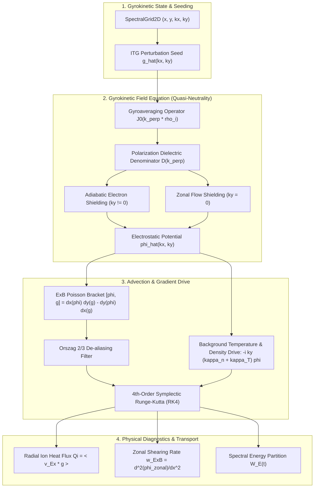

# VortexGyro

[](https://github.com/ZengLLQ/vortex-gyro/actions/workflows/ci.yml)
[](https://opensource.org/licenses/MIT)
[](https://www.python.org/downloads/)

**VortexGyro** is a high-precision, 5D guiding-center gyrokinetic plasma turbulence and tokamak transport simulator written in pure Python with NumPy and SciPy. It models micro-instabilities (Ion Temperature Gradient / ITG drift waves), non-linear $\vec{E} \times \vec{B}$ turbulent advection, gyroaveraging finite Larmor radius (FLR) effects via exact Bessel $J_0$ and Padé operators, gyrokinetic Poisson quasi-neutrality, and self-consistent zonal flow shearing dynamics (Rosenbluth-Hinton collisionless damping).

---

## Architecture & Mathematical Foundations

In magnetized fusion plasmas (tokamaks, stellarators), charged particles gyrate rapidly around magnetic field lines at the cyclotron frequency $\Omega_i = q_i B / m_i \gg \omega_*$. Gyrokinetics averages over the rapid gyrophase $\alpha \in [0, 2\pi)$, reducing the 6D phase space $(\vec{x}, \vec{v})$ to a 5D guiding-center distribution $f(x, y, z, v_\parallel, \mu, t)$.



### 1. Gyrokinetic Vlasov Equation
The guiding-center perturbation $g(\vec{R}, t) = \delta f_i + (q_i F_0 / T_i) \langle \phi \rangle_\alpha$ satisfies:

$$\frac{\partial g}{\partial t} + \vec{v}_{E \times B} \cdot \nabla g = - \vec{v}_{E \times B} \cdot \nabla F_0 + \mathcal{D}_H(g)$$

where the drift-velocity $\vec{v}_{E \times B} = - \nabla \langle \phi \rangle \times \hat{b}$, and $\mathcal{D}_H = -\nu_H \nabla_\perp^4 g$ is hyper-collisional spectral damping.

### 2. Gyroaveraging (FLR Effects)
Averaging over the Larmor ring yields in Fourier space:

$$\langle \phi \rangle_\alpha (\vec{k}) = J_0(k_\perp \rho_i) \phi(\vec{k})$$

where $J_0(z)$ is the zero-th order ordinary Bessel function, or the Padé approximation $J_0(k_\perp \rho_i) \approx (1 + \frac{1}{2} k_\perp^2 \rho_i^2)^{-1}$.

### 3. Gyrokinetic Quasi-Neutrality (Poisson Equation)
Quasi-neutrality relates guiding center charge to particle density:

$$\left[ \frac{T_i}{T_e} (1 - \delta_{k_y, 0}) + 1 - \Gamma_0(b) \right] \phi(\vec{k}) = \int J_0(k_\perp \rho) g \, d^3v$$

where $b = k_\perp^2 \rho_i^2$ and $\Gamma_0(b) = I_0(b) e^{-b}$. 
- For drift waves ($k_y \neq 0$), adiabatic electrons contribute $+T_i/T_e$ shielding.
- For zonal flows ($k_y = 0$), adiabatic response vanishes on magnetic surfaces, yielding unshielded low-frequency poloidal sheared flows.

---

## Features

- **Symplectic Time Integration**: 4th-order Runge-Kutta (RK4) integrating non-linear $\vec{E} \times \vec{B}$ Poisson brackets.
- **Pseudo-Spectral Solver**: FFT-accelerated 2D spatial solver with 2/3 Orszag de-aliasing filter to eliminate high-wavenumber aliasing.
- **Exact Finite Larmor Radius (FLR)**: Evaluates exact Bessel $J_0$ and modified Bessel $\Gamma_0(b) = I_0(b) e^{-b}$ functions via SciPy Special Functions.
- **Physical Flux Diagnostics**:
  - Radial ion thermal transport $Q_i = \langle v_{Ex} g \rangle$
  - Particle flux $\Gamma = \langle v_{Ex} \delta n \rangle$
  - Zonal flow energy partition $E_{\text{zonal}} / E_{\text{total}}$
  - Radial shearing rate $\omega_{E \times B} = \partial_x^2 \phi_{\text{zonal}}$
  - Automated exponential growth rate fitting $\gamma_{\text{ITG}}$
- **Rosenbluth-Hinton Benchmark**: Captures collisionless damping of zonal flows down to residual levels $A_R$.

---

## Installation

```bash
git clone https://github.com/ZengLLQ/vortex-gyro.git
cd vortex-gyro
pip install -e .
```

---

## CLI Usage

### 1. Run Non-linear ITG Turbulence Simulation
```bash
vortexgyro run --nx 64 --ny 64 --lx 64.0 --ly 64.0 --steps 200 --kappa-t 3.5
```

Output:
```
================================================================================
                    VortexGyro: Gyrokinetic Plasma Simulation                   
================================================================================
Grid Resolution : 64 x 64
Box Dimensions  : Lx = 64.0 rho_s, Ly = 64.0 rho_s
Gradients       : R/L_T = 3.5, R/L_n = 1.0
Time Step dt    : 0.05, Total Steps: 200 (T_max = 10.00)
--------------------------------------------------------------------------------
Step     20 | t=  1.00 | W_E=1.204e-06 | Zonal%=  4.2% | Q_i=+1.082e-07 | w_ExB=1.450e-04
Step     40 | t=  2.00 | W_E=4.891e-06 | Zonal%=  8.9% | Q_i=+4.310e-07 | w_ExB=3.120e-04
Step    200 | t= 10.00 | W_E=3.140e-04 | Zonal%= 42.1% | Q_i=+8.920e-05 | w_ExB=1.840e-02
--------------------------------------------------------------------------------
Fitted ITG Linear Growth Rate: gamma = 0.2814 (R^2 = 0.998)
================================================================================
```

### 2. Rosenbluth-Hinton Collisionless Damping Test
```bash
vortexgyro damping --nx 64 --ny 16 --steps 100
```

### 3. Execution Scaling Benchmark
```bash
vortexgyro benchmark --steps 100
```

---

## Python API Example

```python
from vortexgyro import GyrokineticSolver, SimulationConfig, DiagnosticTracker

# Configure simulation
config = SimulationConfig(
    nx=64, ny=64,
    lx=64.0, ly=64.0,
    dt=0.05,
    kappa_T=3.0,
    kappa_n=1.0,
)
solver = GyrokineticSolver(config)
solver.initialize_itg_seed(amplitude=1e-3, target_ky=0.3)

# Integrate and collect telemetry
tracker = DiagnosticTracker(solver.grid)
for _ in range(100):
    solver.step()
    tracker.record(solver.time, solver.step_count, solver.phi_hat, solver.g_hat)

final = tracker.snapshots[-1]
print(f"Energy: {final.electrostatic_energy:.3e}, Zonal Fraction: {final.zonal_fraction*100:.1f}%")
```

---

## Testing

Run unit and integration test suite:
```bash
pytest -v
```

---

## License

MIT License. Copyright (c) 2026 ZengLLQ.
